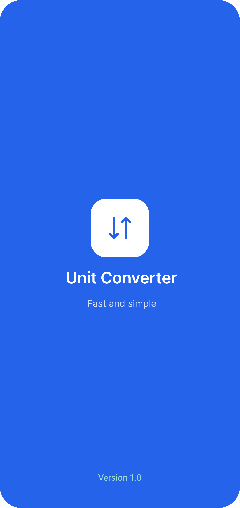
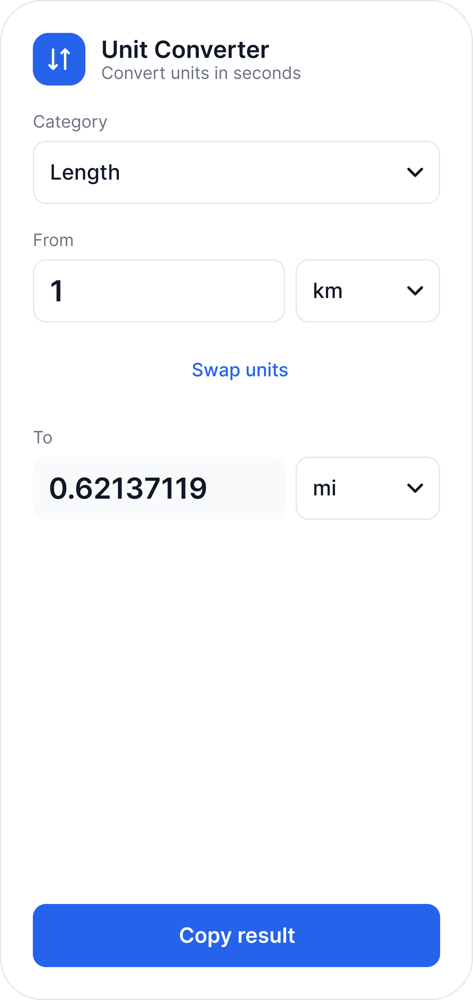

# 📏 Unit Converter App

A clean, simple, and fast unit converter app. Pick a category, type a value, and get the converted result instantly, with a one-tap swap and a copy button.

> 🚧 **Status:** UI/UX design is finished. Implementation is in progress.

---

## 👩‍💻 Developer
* **Name:** Nadia
* **Program:** <!-- e.g. Android App Development Internship (company name) -->

---

## 🌟 Features
* **Splash Screen:** A welcoming blue screen with the app logo, name, and a short tagline, with a smooth fade-out transition.
* **Five Categories:** Length, Weight, Temperature, Volume, and Speed.
* **Real-time Conversion:** The result updates as you type, with no convert button needed.
* **Smart Defaults:** Each category opens with the most useful pair (for example km → mi for Length, °C → °F for Temperature).
* **Swap Units:** Flip the "From" and "To" units with one tap.
* **Copy Result:** Copy the converted value together with its unit.
* **Readable Output:** Very large and very small numbers switch to scientific notation automatically.

---

## 📸 App Screenshots

| Splash Screen | Converter Home |
| :---: | :---: |
|  |  |

*(Note: Place your screenshots inside a `screenshots` folder in the repository for the images to render correctly.)*

---

## 🔄 Supported Units

| Category | Units |
| :--- | :--- |
| Length | m, km, cm, mm, mi, yd, ft, in |
| Weight | kg, g, mg, t, lb, oz |
| Temperature | °C, °F, K |
| Volume | L, mL, m³, gal, cup, fl oz |
| Speed | m/s, km/h, mph, kn |

Conversions for Length, Weight, Volume, and Speed go through a base unit (meter, kilogram, liter, and meter per second). Temperature uses dedicated formulas, converting through Celsius.

---

## 🎨 Design Specs
* **Home screen frame:** 360 × 760, corner radius 32
* **Primary color:** Blue `#2563EB`
* **Text color:** `#111827`
* **Muted text:** `#6B7280`
* **Borders:** `#E5E7EB`
* **Background:** `#F9FAFB`
* **Font:** Inter (fallback: Segoe UI, Roboto, system sans-serif)

---

## 🛠️ Tech Stack & Libraries
<!-- Edit this section to match what you actually use -->
* **Language:** Java
* **UI Frameworks:** Android Views, ConstraintLayout, Material Components
* **Design:** Figma
* **Tools:** Android Studio, Gradle

---

## 📂 Project Structure
```text
com.example.unitconverter
│
├── modules/
│   ├── splash/
│   │   └── views/
│   │       └── SplashActivity.java    # Splash delay and navigation to home
│   │
│   └── home/
│       └── views/
│           └── HomeActivity.java      # Category selection, conversion logic, swap, and copy
│
└── res/
    ├── layout/                        # XML layouts for activity_splash & activity_home
    ├── values/                        # Colors, strings, themes, and styles
    └── drawable/                      # Icons and vector assets
```

---

## 🚀 Getting Started
1. Clone the repository.
2. Open the project in Android Studio.
3. Let Gradle sync, then run the app on an emulator or a device.