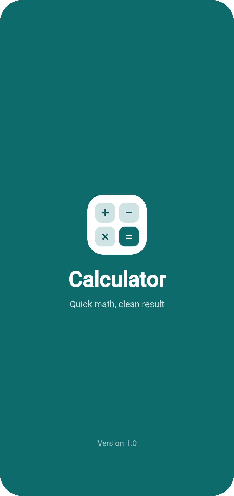
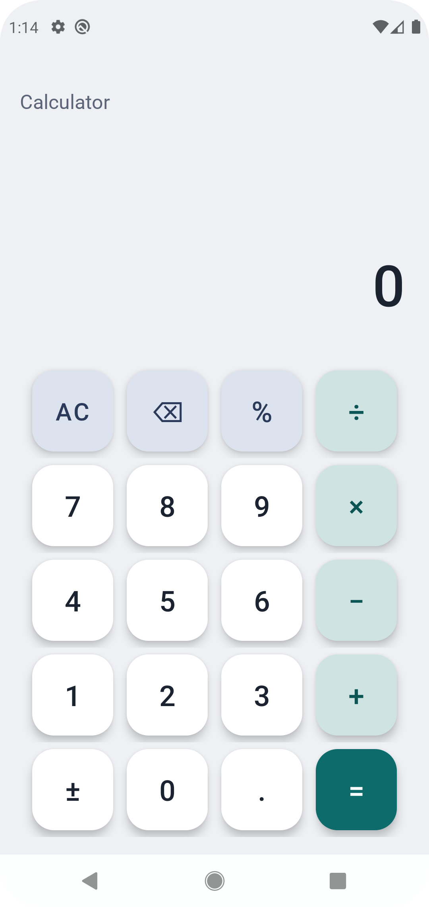

# 📱 Modern Android Calculator Application

A sleek, clean, and modern Android calculator application built with **Java** and **ConstraintLayout**, utilizing **Mozilla Rhino** engine for smooth and accurate expression evaluation. 

This project is developed as **Task 2** for the Android App Development Internship at **Oasis Infobyte**.

---

## 👨‍💻 Developer
* **Name:** Karam Mahmoud Mostafa Salama  
* **Program:** Android App Development Internship (Oasis Infobyte)

---

## 🌟 Features
* **Splash Screen:** A beautifully styled welcoming screen with clean typography, version tracking, and smooth transitions.
* **Modern UI/UX:** Designed following Material Design guidelines with custom color palettes and responsive button margins.
* **Real-time Expression Evaluation:** Powered by the **Mozilla Rhino** JavaScript engine to compute mathematical expressions seamlessly as you type.
* **Essential Operations:** Supports addition, subtraction, multiplication, division, percentage/modulo operations, and decimal calculations.
* **Advanced Controls:** Includes a Clear All (`AC`) option and a functional Backspace (`⌫`) button for correcting inputs.
* **Edge-to-Edge Display:** Implements modern Android window insets for immersive full-screen layouts.

---

## 📸 App Screenshots

| Splash Screen | Calculator Home |
| :---: | :---: |
|  |  |

*(Note: Make sure to place your screenshots inside a `screenshots` folder in your repository directory for the images to render correctly).*

---

## 🛠️ Tech Stack & Libraries
* **Language:** Java
* **UI Frameworks:** Android Views, ConstraintLayout, Material Components (`MaterialButton`)
* **Core Logic Evaluation:** [Mozilla Rhino](https://github.com/mozilla/rhino) (v1.7.14) for evaluating dynamic mathematical strings.
* **Architecture & Tools:** Android Studio, Gradle Version Catalogs (`libs.versions.toml`), Edge-to-Edge API.

---

## 📂 Project Structure
```text
com.example.calculator
│
├── modules/
│   ├── splash/
│   │   └── views/
│   │       └── SplashActivity.java    # Handles splash screen delay and navigation
│   │
│   └── home/
│       └── views/
│           └── HomeActivity.java      # Main calculator logic, click listeners, and Rhino evaluation
│
└── res/
    ├── layout/                        # XML layouts for activity_splash & activity_home
    ├── values/                        # Colors, strings, themes, and styles
    └── drawable/                      # Icons and vector assets
